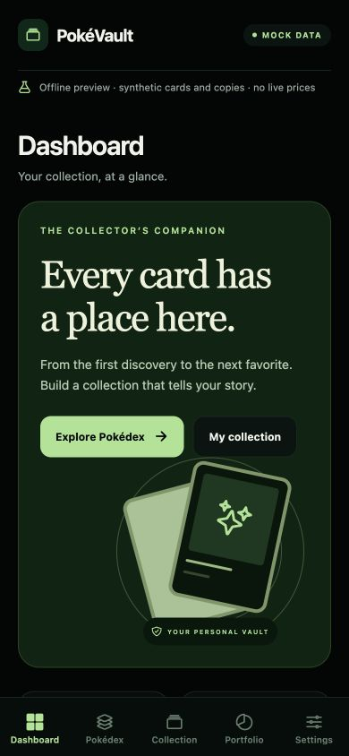
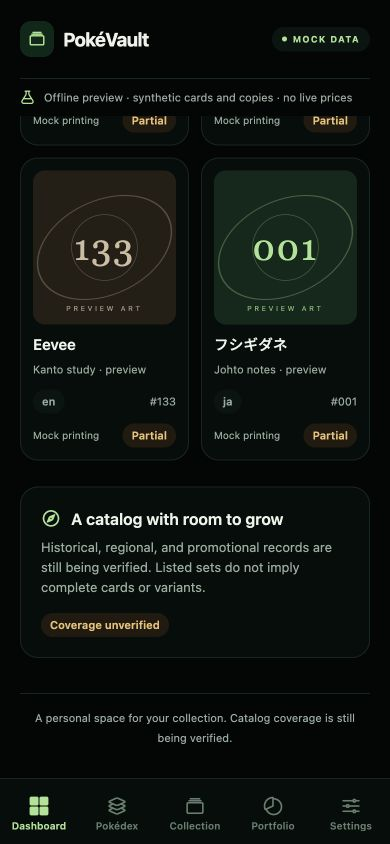

# Sprint 0B — Application Foundation

Completion review: **2026-10-19 (Asia/Manila)**. Scope: Expo / Expo Router / TypeScript mobile-first offline preview. Application foundation: **CONDITIONAL GO**. Full catalog completeness claim: **NO-GO**, unchanged from Sprint 0A.

## Inspection and implementation

The repository already contained the Expo foundation when this request was inspected. It was retained and reviewed rather than reinitialized or overwritten. The missing handoff document is supplied here. The review found that mock labeling scrolled away with content; `Screen` now keeps both the brand/mock badge and the synthetic-data/no-live-prices notice outside the scrolling content on every screen. Settings cannot hide them.

Five Expo Router bottom tabs are implemented: Dashboard, Pokédex, Collection, Portfolio and Settings. Dark-theme components cover surfaces, typography, buttons, filters, metrics, coverage pills, empty states, responsive grids and abstract local artwork. Pokédex supports native-name/number search and language/era filtering; Collection supports review filters and date ordering; Settings changes display preferences only for the current session. Portfolio supplies no fabricated prices or acquisition costs.

The synthetic fixtures demonstrate multiple languages, separate localized printings, string collector numbers, unnumbered Trainer cards, multi-species cards, explicit provisional variants and unknown copy identification. Era/language vocabulary is extensible and **does not establish populated historical catalog coverage**. Synthetic releases and numbering are not real card checklists.

Canonical identities are branded internal UUIDs. Upstream keys remain separately scoped by provider, locale, domain and parent card. Catalog/pricing contracts and collection contracts are separate. Canonical catalog upserts retain omitted records and have no access to an owned-copy repository or a copy-deletion operation. This is a foundation boundary, not an implemented production synchronization or persistent storage service.

## Files delivered

The following foundation files were present at inspection, reviewed and validated in this completion pass:

| Area | Files |
| --- | --- |
| Project and npm configuration | `package.json`, `package-lock.json`, `app.json`, `tsconfig.json`, `.gitignore` |
| Expo Router | `src/app/_layout.tsx`, `src/app/(tabs)/_layout.tsx`, `index.tsx`, `pokedex.tsx`, `collection.tsx`, `portfolio.tsx`, `settings.tsx` inside the tabs directory |
| Shared UI and theme | `src/components/ui.tsx`, `src/theme/tokens.ts`, `src/theme/useResponsiveWidth.ts` |
| Domain | `src/domain/models.ts`, `src/domain/identity.ts`, `src/domain/catalog.ts` |
| Provider boundaries | `src/providers/contracts.ts`, `src/providers/mock.ts` |
| Synthetic data/state | `src/data/mock.ts`, `src/state/preview.tsx` |
| Automated checks | `eslint.config.js`, `jest.config.js`, `jest.setup.js`, `__tests__/domain.test.ts`, `__tests__/providers.test.ts`, `__tests__/navigation.test.tsx` |
| Audit protection | `scripts/audit-baseline.json`, `scripts/verify-audit.mjs` |
| Existing documentation | `AGENTS.md`, `README.md`, dated Sprint 0B implementation notes in requirements, architecture and backlog |

Changed in this completion pass: `src/components/ui.tsx` (fixed mock header); appended dated validation notes to `docs/requirements.md`, `docs/architecture.md` and `docs/backlog.md`; updated the README handoff note. Created this report, `docs/previews/sprint-0b-*-mobile.png` screenshots and `docs/previews/sprint-0b-responsive-checks.json`. Earlier preview files were left intact; the new prefixed screenshots reflect the fixed header.

Generated artifacts: ignored `dist/` from web export; native JavaScript bundles under `/tmp/pokevault-sprint0b-native/`; Expo's generated environment type file. No project initializer was run and dependencies/lockfile were not replaced in this completion pass. The repository currently has untracked project files; no commit, push or deployment was performed.

## Commands executed and actual results

Runtime observed: Node **24.18.0**, npm **11.16.0**. Commands were run from the repository root unless indicated.

| Command / check | Actual result |
| --- | --- |
| `npm run check` | **PASS**, run before and after the header change. Executes audit verification, TypeScript, zero-warning ESLint and Jest. |
| `npm run verify:audit` via `check` | **PASS: 194 protected Sprint 0A files unchanged**, including the audit, matrix and saved evidence. Baseline not regenerated. |
| `npm run typecheck` via `check` | **PASS**, `tsc --noEmit`. |
| `npm run lint` via `check` | **PASS**, `eslint . --max-warnings=0`. |
| `npm test` via `check` | **PASS: 3 suites, 24 tests**; no snapshots. Final application-code run took 3.893 seconds. |
| `npm run export:web` | **PASS**, Metro produced the web bundle and 12 static routes, including the five primary routes and their group-path equivalents. |
| `npx expo export --platform ios --platform android --output-dir /tmp/pokevault-sprint0b-native` | **PASS**, iOS and Android Hermes JavaScript bundles and assets generated. This is not a native binary build or device run. |
| `EXPO_OFFLINE=1 npx expo install --check` | Reported dependencies up to date, with the CLI warning that validation is unreliable offline. **Qualified result**, not a fresh online compatibility certification. |
| `EXPO_OFFLINE=1 npm run web -- --port 8082` | Initial sandbox launch did not expose a usable listener; initial browser connection was refused. Restart outside the sandbox succeeded: Expo/Metro reported `http://localhost:8082` and the browser rendered the application. |
| Browser interactions | **PASS**, all five real tab buttons selected and each matching screen/mock notice rendered. Japanese search `フシギ` returned one mock result. |
| Responsive browser checks | **PASS**, all five screens at **320, 768 and 1280 px** had document width equal to viewport width; screenshots also inspected at **390 × 844**. This page-width assertion does not certify every child layout or accessibility configuration. |
| Scrolled mobile preview | **PASS**, fixed `MOCK DATA` badge and no-live-prices notice remained on screen after scrolling Dashboard to its lower content. |
| Browser console inspection | No warning/error entries returned during the check. |

Read-only inspection commands included `pwd`, `ls`, `rg`, `cat`, `head`, `tail`, `git status --short`, `node --version` and `npm --version`. `ps` was attempted to diagnose the stalled sandbox launch but was denied by the sandbox; it was not needed after restarting the authorized local server. Browser checks used the in-app browser. No external catalog/pricing requests, credentials, package installation or paid integrations were involved.

Automated tests cover UUID identity boundaries, scoped external IDs, native-name search, string collector numbers, multi-species/species-free printings, unknown variants, copy/variant reference integrity, idempotent non-destructive upserts, audited empty-shell semantics, unknown completion denominators, locale/domain provider limitations, absent pricing, five-tab navigation, filters and display preferences. Jest uses `jest-expo` native mocks; it is separate from browser and device verification.

## Acceptance review

| Criterion | Result |
| --- | --- |
| Expo starts | Passed in local web development mode after resolving sandbox listener access. |
| Five screens render and bottom tabs work | Passed in real browser interactions and Expo Router integration tests. |
| Persistent mock-data distinction | Passed; fixed header cannot be disabled and remains visible on scroll. |
| Multilingual printing/variant domain | Implemented and tested; not a claim all language records exist. |
| Internal identity independence | Internal UUIDs separated from externally scoped mappings. |
| Multiple catalog/pricing provider preparation | Interfaces and mock implementations supplied; no live adapters. |
| Missing/partial/unverified catalog support | Explicit model states and preview cases; unknown denominators yield no ratio. |
| Personal-copy protection | Catalog upsert boundary accepts no collection aggregate and exposes no copy delete. No production sync is implemented. |
| TypeScript, lint, unit/integration tests | Passed. |
| Existing audit documentation and evidence intact | All 194 protected file hashes passed unchanged. Requirements/architecture/backlog only receive dated implementation notes. |

## Remaining limits

**Physical iOS/Android device and emulator testing was not performed.** Native bundle exports validate bundling only. Expo Go compatibility on the user's installed client, device safe areas, system font scaling, screen readers, touch/keyboard behavior and platform-specific runtime behavior still require device checks. Browser responsive checks do not replace these.

No real collection persistence/editing, production backend, database migrations, authentication, production scanning, paid feeds, production catalog/pricing adapters, acquisition accounting, market valuation, image licensing integration, release completeness certification, app-store build or deployment is included. No real ownership records should be entered into the read-only demo. Future adapters need actual normalization, provenance, mapping review, cancellation/retry/checkpointing and rights qualification.

## Run and next steps

```sh
npm ci
npm start
# Browser preview:
EXPO_OFFLINE=1 npm run web -- --port 8082
```

The validated local preview server was left running for review at [localhost:8082](http://localhost:8082). Server lifetime depends on the active local session; rerun the command if it stops. Device launch requires a compatible Expo Go client or the appropriate native development environment.

Next: perform device acceptance; independently verify release/language applicability and data rights; qualify a staged catalog adapter; design persistent personal-copy storage without cascading catalog deletion. Continue to report catalog completeness as unverified/partial until the Sprint 0A checklist and reconciliation gates are satisfied.




